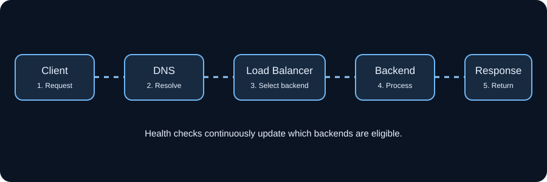
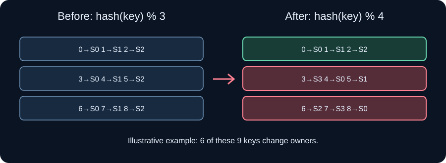
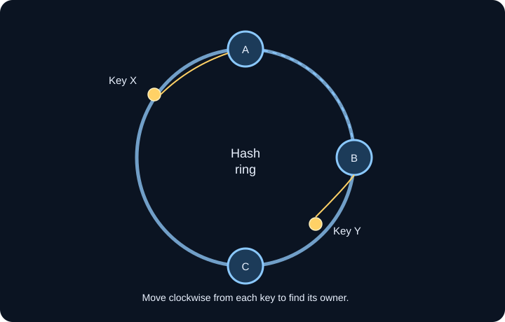
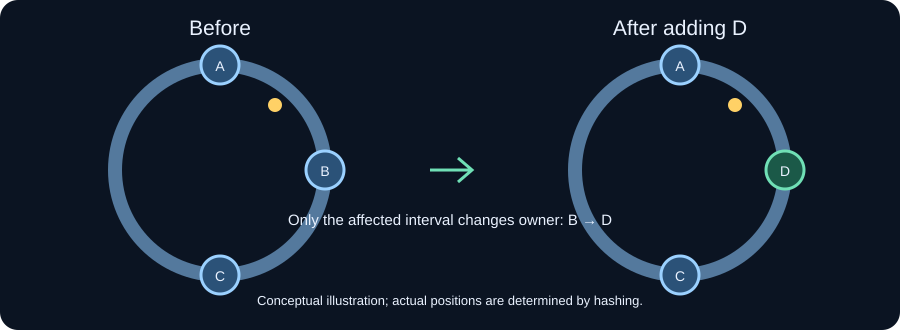
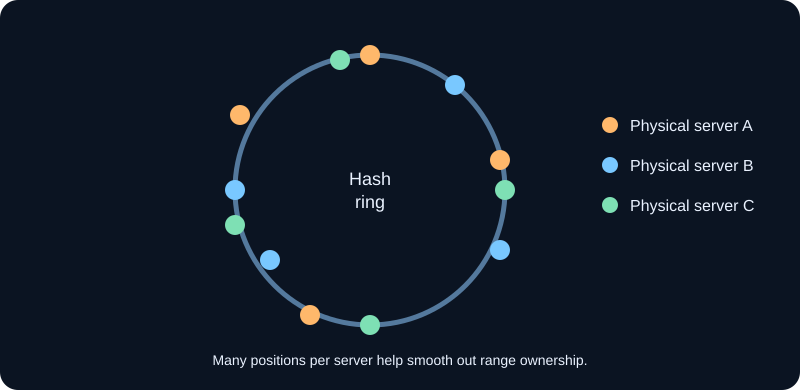

# Load Balancing & Consistent Hashing — Complete Deep Dive

---

## PART 1: LOAD BALANCING

---

### 📌 Definition

A **Load Balancer** is a system (hardware or software) that sits in front of a group of servers and **distributes incoming network requests** across those servers so that no single server becomes a bottleneck.

Think of it as the **traffic cop** at a busy intersection — it decides which car (request) goes to which lane (server).

---

### ❓ Why Do We Need It?

Imagine you open a small tea stall with one person making tea. When 2–3 people come, it's fine. But during a festival, 500 people show up. What happens?

- The one person gets overwhelmed
- People wait forever
- The person collapses (server crash)

You could hire a second, third, or fourth person — but then you need a **manager at the front** to tell each customer which tea-maker to go to. That manager = Load Balancer.

**Without Load Balancing:**
- One server handles all traffic → it crashes under heavy load
- If that server goes down → entire application goes down
- You can't scale

**With Load Balancing:**
- Traffic is spread evenly across multiple servers
- If one server crashes, others keep serving
- You can add new servers anytime (horizontal scaling)

---

### 🕐 When Is It Needed?

| Situation | Why LB helps |
|---|---|
| High traffic (millions of users) | Prevents any one server from being overwhelmed |
| You want zero downtime | If one server dies, LB routes to others |
| You want to scale horizontally | Just add more servers behind the LB |
| Servers in multiple regions/data centers | Route user to nearest/fastest server |

---

### ⚙️ How Does Load Balancing Work — Step by Step

**Setup:** You have 3 servers: S1, S2, S3. A load balancer (LB) sits in front.

```
User Request
     ↓
  [Load Balancer]
   /     |     \
  S1     S2     S3
```



**Step 1:** User types `www.cgecsocial.in` in browser. DNS resolves to the Load Balancer's IP.

**Step 2:** The request hits the LB, NOT the actual server.

**Step 3:** LB applies an **algorithm** to decide which server gets this request.

**Step 4:** LB forwards the request to that server (say S2).

**Step 5:** S2 processes it and sends response back through LB (or directly) to the user.



---

### 🔄 Load Balancing Algorithms

**1. Round Robin** (most basic)
Requests go to servers in a circular order: S1 → S2 → S3 → S1 → S2 → S3 → ...

- Simple, works when all servers have equal capacity
- Problem: doesn't consider server load — S1 might be struggling while S3 is idle

**2. Least Connections**
Route the new request to whichever server currently has the fewest active connections.

- Smarter than round robin
- Good when requests vary in processing time

**3. IP Hash / Request Hash**
Hash the user's IP or request ID → that determines the server.

- Same user always goes to same server (more on this later — this is "stickiness")

**4. Weighted Round Robin**
Stronger servers get more requests. If S1 has 8GB RAM and S2 has 4GB: S1 gets 2 requests for every 1 that S2 gets.

---

### 🏙️ Real-World Analogy — Airport Check-in

You arrive at an airport. There are 10 check-in counters. A ground staff member at the entrance (the Load Balancer) checks which counter has the shortest queue and tells you: "Go to Counter 4."

- If Counter 4 breaks down (server crash), she redirects everyone to other counters.
- If 500 more passengers arrive, the airport opens more counters (horizontal scaling).
- The entrance staff ensures no single counter is mobbed.

---

### 🌍 Real-World Example

**Netflix** handles millions of concurrent streams. When you press Play:

1. Your request hits a Netflix Load Balancer
2. LB checks which of Netflix's hundreds of servers is least loaded and closest to you
3. Routes your request there
4. That server starts streaming your video

If that server dies mid-stream, the LB can redirect your session to another server — you might see a 2-second buffer, that's it.

---
---

## PART 2: THE PROBLEM WITH SIMPLE HASHING

---

### 📌 Definition

**Hashing in load balancing** means: take some property of the request (like user ID, session ID, or IP address), run it through a hash function, and use the result to decide which server handles it.

**Formula:**
```
server_index = hash(request_key) % number_of_servers
```

---

### ✅ Why Use Hashing at All?

A big reason is **Request Stickiness**.

Imagine a user logs into your platform. Their session data (login state, cart, preferences) is stored in RAM on **Server 2**. If the next request from the same user goes to **Server 1**, Server 1 doesn't have that session data → user gets logged out or loses cart.

**Hashing ensures the same user always goes to the same server**, because `hash(userID) % N` always gives the same result for the same user.

---

### 💥 The Catastrophic Problem: Adding or Removing a Server

This is where simple hashing completely falls apart.

**Example — Step by Step:**

You have **3 servers**: S0, S1, S2.
You have 9 users with IDs 0 through 8.

```
hash(userID) % 3

User 0 → 0 % 3 = 0 → S0
User 1 → 1 % 3 = 1 → S1
User 2 → 2 % 3 = 2 → S2
User 3 → 3 % 3 = 0 → S0
User 4 → 4 % 3 = 1 → S1
User 5 → 5 % 3 = 2 → S2
User 6 → 6 % 3 = 0 → S0
User 7 → 7 % 3 = 1 → S1
User 8 → 8 % 3 = 2 → S2
```

This is working great. Each server holds cached data for its assigned users.

**Now you add a 4th server (S3)** because traffic increased.

New formula: `hash(userID) % 4`

```
User 0 → 0 % 4 = 0 → S0 ✅ (same)
User 1 → 1 % 4 = 1 → S1 ✅ (same)
User 2 → 2 % 4 = 2 → S2 ✅ (same)
User 3 → 3 % 4 = 3 → S3 ❌ (was S0, now S3 — MISS)
User 4 → 4 % 4 = 0 → S0 ❌ (was S1, now S0 — MISS)
User 5 → 5 % 4 = 1 → S1 ❌ (was S2, now S1 — MISS)
User 6 → 6 % 4 = 2 → S2 ✅ (same)
User 7 → 7 % 4 = 3 → S3 ❌ (was S1, now S3 — MISS)
User 8 → 8 % 4 = 0 → S0 ❌ (was S2, now S0 — MISS)
```



**6 out of 9 users** got remapped! That's ~67% cache miss.

In a real system with millions of users and cached database results, this means:
- 67% of requests suddenly can't find their cached data
- All those requests slam your database directly
- Database gets overloaded
- System slows to a crawl or crashes
- This is called a **cache stampede**

The same disaster happens when a server **crashes** — `% N` becomes `% (N-1)` and again, nearly everything remaps.

---
---

## PART 3: CONSISTENT HASHING — THE SOLUTION

---

### 📌 Definition

**Consistent Hashing** is a hashing technique where both **servers and requests** are mapped onto a virtual circular space (called a **hash ring** or **hash circle**), such that when servers are added or removed, **only a minimal fraction of keys need to be remapped** — only the keys that were assigned to that specific server.

---

### ❓ Why Is It Called "Consistent"?

Because the mapping stays **consistent** even when the cluster size changes. Unlike `% N` hashing (which changes the assignment of *almost everything* when N changes), consistent hashing guarantees that only `K/N` keys get remapped when a server is added (K = total keys, N = number of servers).

---

### 🕐 When Is It Used?

| System | Why |
|---|---|
| Distributed caches (Redis Cluster, Memcached) | Cache data must stay on the right node |
| Distributed databases (Cassandra, DynamoDB) | Data partitioned across nodes |
| CDNs (Akamai, Cloudflare) | Route requests to right edge server |
| Peer-to-peer networks (BitTorrent, Chord DHT) | Find which peer holds a file |
| Load balancing with session stickiness | Same user always hits same backend |

---

### ⚙️ How Consistent Hashing Works — Step by Step

**Step 1: Create the Hash Ring**

Imagine a circle with positions ranging from 0 to 2³² - 1 (about 4 billion positions), and the ends wrap around (so after the max position, you're back at 0). This is the **hash ring**.

```
         0 / 4B
        /        \
     3B            1B
        \        /
         2B
```

**Step 2: Place Servers on the Ring**

Hash each server's name or IP using the same hash function (like MD5 or SHA-1), and place it at that position on the ring.

Say you have 3 servers:
```
hash("Server_A") → 1 billion  → placed at position 1B
hash("Server_B") → 2 billion  → placed at position 2B
hash("Server_C") → 3 billion  → placed at position 3B
```

The ring now looks like:

```
              0 / 4B
             /        \
           3B           1B
         [C]             [A]
              \        /
               2B
              [B]
```

**Step 3: Place Requests on the Ring**

Hash each incoming request's key (user ID, session ID, etc.) and place it at that position on the ring.

```
hash(userID_5)  → 500 million  → position 500M
hash(userID_12) → 1.5 billion  → position 1.5B
hash(userID_7)  → 2.5 billion  → position 2.5B
```

**Step 4: Assign Request to Server — The "Clockwise" Rule**

For each request, **travel clockwise on the ring** from the request's position until you hit a server. That server handles the request.

```
User 5  (at 500M)  → go clockwise → first server hit = A (at 1B) → Assigned to A
User 12 (at 1.5B)  → go clockwise → first server hit = B (at 2B) → Assigned to B
User 7  (at 2.5B)  → go clockwise → first server hit = C (at 3B) → Assigned to C
```

Each server "owns" all positions on the ring from just after the previous server up to and including its own position.



---

### ➕ What Happens When You ADD a Server?

You add Server D at position 1.5 billion.

```
Before D:  Request at 1.2B → travels clockwise → hits A (at 1B)? 
Wait — 1.2B > 1B, so it passes A and goes to... B (at 2B). So request at 1.2B was going to B.

After D:   Request at 1.2B → travels clockwise → hits D (at 1.5B). Now goes to D.
```

**Only the requests that fall between position 1B and 1.5B change their assignment** (from B to D). Everything else stays exactly where it was.



If you had 1 million users spread across 3 servers, adding a 4th server means roughly 1/4 of users (250,000) get remapped. The other 750,000 are completely undisturbed.

Compare to simple hashing: adding a 4th server remaps ~75% of users!

---

### ➖ What Happens When a Server CRASHES/REMOVES?

Server B (at 2B) crashes.

```
Before:  Requests between 1B and 2B → go to B
After:   Requests between 1B and 2B → travel clockwise past where B was → now hit C (at 3B)
```

Only B's users get remapped (to C). Users of A and C are completely unaffected.

---

### ⚖️ The Hotspot Problem & Virtual Nodes

**New Problem:** With only 3 real servers, the arc lengths between them might be very uneven. One server might "own" 60% of the ring while another owns only 10%. That's unequal load.

**Solution: Virtual Nodes (VNodes)**

Instead of placing each server once on the ring, place it **multiple times** at different positions using different hashes:

```
hash("Server_A_0") → position X
hash("Server_A_1") → position Y
hash("Server_A_2") → position Z
hash("Server_B_0") → position P
hash("Server_B_1") → position Q
...etc
```

Now Server A has 3 "virtual" positions spread around the ring. So even if real arc lengths are uneven, the load averages out because each server occupies multiple arcs.

A server with more capacity gets more virtual nodes → gets proportionally more load. This is like **weighted load balancing** but on the ring.



---

### 🏠 Real-World Analogy — Pizza Delivery Zones

Imagine a city is a circle. 3 pizza shops (A, B, C) are placed at different points around the city. When a customer orders, the rule is: **the closest shop in the clockwise direction delivers**.

- Shop A covers Zone 1 (12 o'clock to 4 o'clock)
- Shop B covers Zone 2 (4 o'clock to 8 o'clock)
- Shop C covers Zone 3 (8 o'clock to 12 o'clock)

**You open a new Shop D** between A and B. Now D takes over part of B's zone. Only customers in that sub-zone switch from B to D. Everyone else's delivery shop stays the same.

**Shop B closes.** Its customers automatically get reassigned to Shop C (next clockwise). Shops A and D are completely unaffected.

---

### 🌍 Real-World Example — Amazon DynamoDB

DynamoDB is a massively distributed NoSQL database. Your data is split across dozens of servers.

When you write a record (say, your CGEC Socials user profile), DynamoDB hashes your user ID, finds its position on the ring, and stores it on the server that owns that ring position.

When you read it back, the same hash → same ring position → same server → data found.

If Amazon needs to add more capacity (more servers), only ~1/N of the existing data needs to migrate. The rest stays put. No massive data shuffle, no downtime.

---

### 🌍 Real-World Example — Cassandra

Apache Cassandra explicitly uses consistent hashing with virtual nodes. Each Cassandra node owns several token ranges (virtual positions) on a 128-bit hash ring. When you add a node:
1. It automatically takes over some token ranges from neighbors
2. Only the data in those ranges moves
3. The cluster rebalances itself with minimal disruption

---

## Comparison Summary

| Feature | Simple `% N` Hashing | Consistent Hashing |
|---|---|---|
| Keys remapped when server added | ~(N-1)/N (most keys) | ~K/N (just 1 server's worth) |
| Keys remapped when server removed | ~(N-1)/N (most keys) | Only the crashed server's keys |
| Load balance | Even (by count) | Can be uneven without VNodes |
| Implementation complexity | Very simple | Moderate |
| Use case | Stateless, non-cached requests | Caches, DBs, session-sticky systems |

---

## One-Line Mental Model

> **Simple hashing:** "Change the number of servers, change almost everything."
> **Consistent hashing:** "Change the number of servers, change only what that server was responsible for."

That's the entire insight. Consistent hashing minimizes disruption by making each server own a *region* of the ring rather than every Nth key globally.