# Load Balancing Algorithms — Complete Deep Dive

---

## Before We Start: The Two Layers of Load Balancing

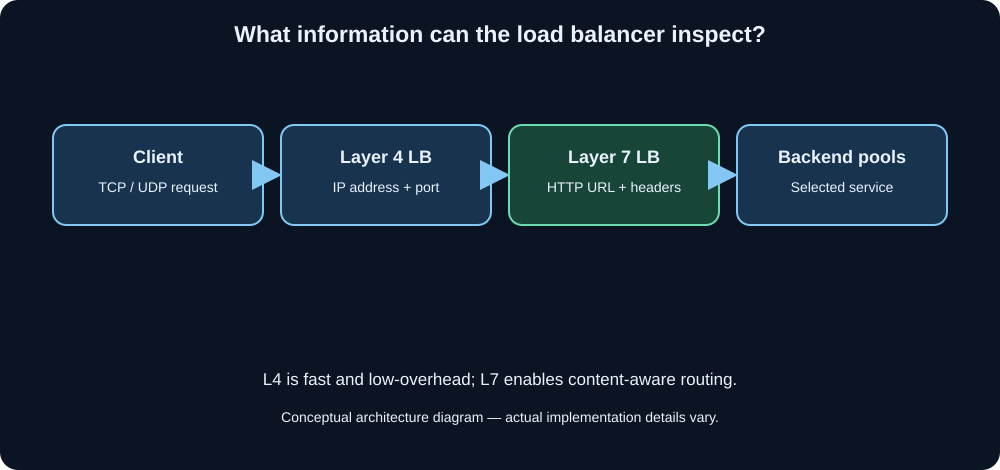

Every LB algorithm operates at one of two levels. This matters for understanding which algo can "see" what.

**Layer 4 (Transport Layer)** — The LB sees only IP address and TCP/UDP port. It doesn't know what's inside the packet (is it a login request? a file upload? a video stream?). Fast, low overhead.

**Layer 7 (Application Layer)** — The LB actually reads the HTTP request — URL, headers, cookies, body content. Slower, but much smarter routing decisions.

Most algorithms below can be used at either layer, but some (like URL-based routing) **require** Layer 7.

---

## THE ALGORITHMS

---

## 1. Round Robin

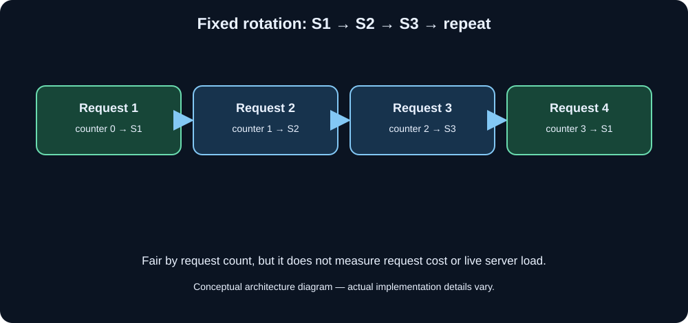

---

### 📌 Definition

The simplest possible algorithm. Requests are sent to servers in a fixed circular order: S1 → S2 → S3 → S1 → S2 → S3 → ... and so on. Each server gets exactly one turn before the cycle repeats.

---

### ⚙️ How It Works — Step by Step

You have 3 servers: S1, S2, S3. The LB maintains an internal counter.

```
Request 1  → counter = 0 → 0 % 3 = 0 → S1
Request 2  → counter = 1 → 1 % 3 = 1 → S2
Request 3  → counter = 2 → 2 % 3 = 2 → S3
Request 4  → counter = 3 → 3 % 3 = 0 → S1
Request 5  → counter = 4 → 4 % 3 = 1 → S2
...
```

That's it. Pure mechanical rotation. The LB doesn't care about server health, load, or request size. Just whose turn it is.

---

### ✅ Advantages

- Extremely simple to implement and understand
- Zero overhead — no need to track any server state
- Perfectly fair distribution *by count* — every server gets the same number of requests
- Works well when all servers are identical in hardware AND all requests are similar in cost

---

### ❌ Problems & Limits

**Problem 1: Assumes equal server capacity**
If S1 is a powerful 32-core machine and S2 is a weak 2-core machine, they both get the same number of requests. S2 drowns.

**Problem 2: Assumes equal request cost**
Request 1 might be "fetch homepage" (2ms) and Request 2 might be "generate PDF report" (5 seconds). S2 gets the PDF job and is stuck. Meanwhile S1 finishes instantly and is idle — but the next 2 requests still go to S2 and S3 mechanically, even though S1 is free.

**Problem 3: No session stickiness**
The same user hits S1 on login, S2 on the next click, S3 after that. If session data is stored in server memory, the user gets logged out or sees stale data repeatedly.

**Problem 4: Doesn't account for server health in time**
If S2 is about to crash (CPU at 99%), round robin still sends it requests cheerfully.

---

### 🔧 How to Solve

| Problem | Solution |
|---|---|
| Unequal server capacity | Upgrade to Weighted Round Robin (next algo) |
| Unequal request cost | Upgrade to Least Connections |
| No stickiness | Add sticky sessions via cookie or use IP Hash |
| No health awareness | Add health checks — if a server fails checks, skip it in the rotation |

---

### 🏠 Analogy

4 cashiers at a supermarket. A manager outside the store assigns each customer to the next cashier in rotation — regardless of whether cashier 3 is currently handling a person with 100 items while cashier 1 just finished and is free.

---

### 🌍 Real-World Use

Good for: stateless APIs where every request is about the same cost (e.g., serving static assets, simple REST lookups).

Used by: Nginx (default), HAProxy, AWS ALB (can be configured this way).

---
---

## 2. Weighted Round Robin

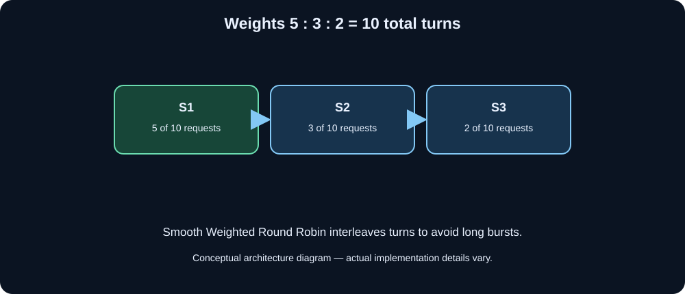

---

### 📌 Definition

An extension of Round Robin where each server is assigned a **weight** (a number representing its relative capacity). Servers with higher weights receive proportionally more requests per cycle.

---

### ⚙️ How It Works — Step by Step

You have 3 servers with different capacities:

```
S1: weight = 5  (powerful server)
S2: weight = 3  (medium server)
S3: weight = 2  (weak server)
Total weight = 10
```

In every 10 requests:
- S1 handles 5
- S2 handles 3
- S3 handles 2

The LB builds a **weighted sequence**: [S1, S1, S1, S1, S1, S2, S2, S2, S3, S3] and rotates through it.

```
Request 1  → S1
Request 2  → S1
Request 3  → S1
Request 4  → S1
Request 5  → S1
Request 6  → S2
Request 7  → S2
Request 8  → S2
Request 9  → S3
Request 10 → S3
Request 11 → S1 (cycle repeats)
```

A smarter implementation (like Nginx's) uses the **Smooth Weighted Round Robin** algorithm which spreads the assignments more evenly rather than giving S1 all 5 turns in a row:

```
Request 1  → S1
Request 2  → S1
Request 3  → S2
Request 4  → S1
Request 5  → S2
Request 6  → S1
Request 7  → S3
Request 8  → S1
Request 9  → S2
Request 10 → S3
```

This prevents any single server from being hit in a burst.

---

### ✅ Advantages

- Handles heterogeneous server farms (different capacity machines)
- Still simple — just static weights, no need to monitor live server state
- Easy to configure (just set a number per server)
- Smooth weighted variant gives a more even distribution over time

---

### ❌ Problems & Limits

**Problem 1: Weights are static**
Weights are set at configuration time. If S1 starts struggling at 3 AM due to a memory leak, the LB still sends it 50% of traffic because that's what the weight says. The weight doesn't auto-adjust.

**Problem 2: Still doesn't account for varying request cost**
S1 might get 5 requests in a cycle, but if those 5 requests happen to all be heavy file uploads, S1 is overwhelmed while S2 and S3 are sitting idle.

**Problem 3: No real-time feedback**
The LB is operating blind — it doesn't know what's actually happening inside the servers.

---

### 🔧 How to Solve

| Problem | Solution |
|---|---|
| Static weights can't adapt | Use health checks + dynamic weight adjustment (some advanced LBs do this automatically) |
| Still cost-blind | Combine with Least Connections |
| Blind to server internals | Use Resource-Based/Adaptive algorithm (covered later) |

---

### 🏠 Analogy

Same supermarket. Now you know Cashier 1 is fast (processes 5 people/min), Cashier 2 is medium (3/min), Cashier 3 is slow (2/min). The manager assigns customers proportionally — 5 to Cashier 1 for every 2 assigned to Cashier 3.

---

### 🌍 Real-World Use

Used when you have mixed hardware — maybe old servers and new servers in the same pool. Set higher weight on new servers.

Used by: Nginx (`weight` parameter in upstream block), HAProxy, AWS ALB target group weights.

---
---

## 3. Least Connections (Least Conn)

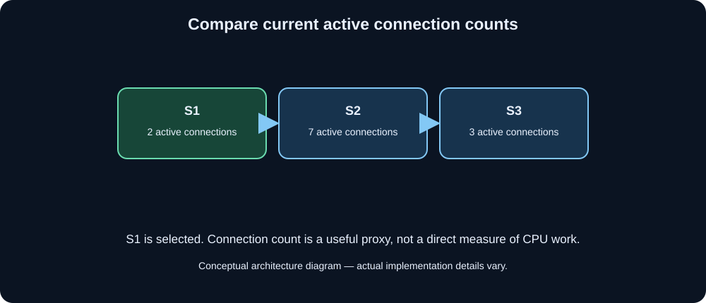

---

### 📌 Definition

Instead of rotating blindly, the LB tracks how many **active (open) connections** each server currently has. Every new request goes to the server with the **fewest current active connections**.

---

### ⚙️ How It Works — Step by Step

LB maintains a live connection count table:

```
Initial state:
S1: 0 connections
S2: 0 connections
S3: 0 connections
```

```
Request 1 arrives → min is 0 (all tied) → pick S1 (tiebreak, e.g. first in list)
State: S1=1, S2=0, S3=0

Request 2 arrives → min is 0 → pick S2
State: S1=1, S2=1, S3=0

Request 3 arrives → min is 0 → pick S3
State: S1=1, S2=1, S3=1

Request 4 arrives → all equal at 1 → pick S1 (tiebreak)
State: S1=2, S2=1, S3=1
```

Now something important happens. Request 1 to S1 finishes quickly (it was a simple query):

```
S1 drops to 1 connection.
State: S1=1, S2=1, S3=1
```

But S2 got a heavy request (file upload, still ongoing):

```
Request 5 arrives → S1=1, S2=1, S3=1 → tiebreak → S1
Request 6 arrives → S1=2, S2=1, S3=1 → min is S2... 
but wait — S2 is still processing that heavy upload. 
In Round Robin, Request 6 would still go to S2!
In Least Connections, it goes to S3 (or S1 depending on counts).
```

This is the key insight: Least Connections naturally adapts to request duration.

---

### ✅ Advantages

- Adapts to varying request processing times automatically
- Servers doing heavy work get fewer new requests
- Servers that finish quickly get more requests
- Much fairer than Round Robin for mixed workloads
- Works well with long-lived connections (WebSockets, streaming, file transfers)

---

### ❌ Problems & Limits

**Problem 1: Assumes connection count = server load**
A server might have 10 connections but each is a tiny idle keep-alive connection. Another server has 3 connections but each is doing intensive database computation. Connection count ≠ CPU usage.

**Problem 2: Thundering herd on startup**
All servers start with 0 connections. The first N requests (where N = number of servers) all go to different servers, fine. But on a cold start with burst traffic, the first server in the tiebreak gets hammered.

**Problem 3: Overhead of tracking**
The LB must maintain and update a counter per server per connection open/close. At millions of requests/second, this adds synchronization overhead.

**Problem 4: Doesn't account for server capacity differences**
A weak server and a strong server both at 10 connections — the LB treats them equally. But the weak server is struggling and the strong server is barely working.

---

### 🔧 How to Solve

| Problem | Solution |
|---|---|
| Connection count ≠ real load | Use Least Response Time (measures actual speed) |
| Ignores server capacity | Use Weighted Least Connections (next algo) |
| Cold start thundering herd | Add a slow-start mode (gradually ramp up new servers) |

---

### 🏠 Analogy

A hospital with 3 doctors. A receptionist (LB) tracks how many patients each doctor currently has. Every new patient goes to whichever doctor has the fewest current patients — not based on a rotation, but based on live reality.

---

### 🌍 Real-World Use

Excellent for: APIs with mixed request types (some fast, some slow), streaming services, WebSocket servers, file upload/download services.

Used by: HAProxy (`leastconn`), Nginx Plus, AWS ALB.

---
---

## 4. Weighted Least Connections

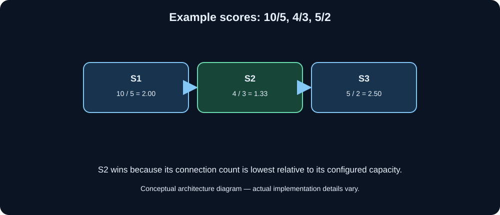

---

### 📌 Definition

Combines Weighted Round Robin's awareness of server capacity with Least Connection's awareness of current load. The assignment is based on:

```
score = active_connections / weight
```

The server with the **lowest score** gets the next request.

---

### ⚙️ How It Works — Step by Step

```
S1: weight=5, active connections=10 → score = 10/5 = 2.0
S2: weight=3, active connections=4  → score = 4/3  = 1.33
S3: weight=2, active connections=5  → score = 5/2  = 2.5
```

Next request goes to S2 (lowest score = 1.33).

Interpretation: S2's connections are "lighter" relative to its capacity than S1 or S3's.

---

### ✅ Advantages

- Best of both worlds: accounts for both capacity AND current load
- Powerful servers naturally absorb more connections before their score rises
- Weak servers don't get overwhelmed

---

### ❌ Problems & Limits

- More complex to implement than pure least connections
- Weights are still static (don't auto-adapt)
- Still uses connection count as a proxy for load, not actual CPU/RAM

---

### 🌍 Real-World Use

HAProxy supports this. Good for mixed hardware clusters where requests also vary in cost.

---
---

## 5. IP Hash (Source IP Affinity)

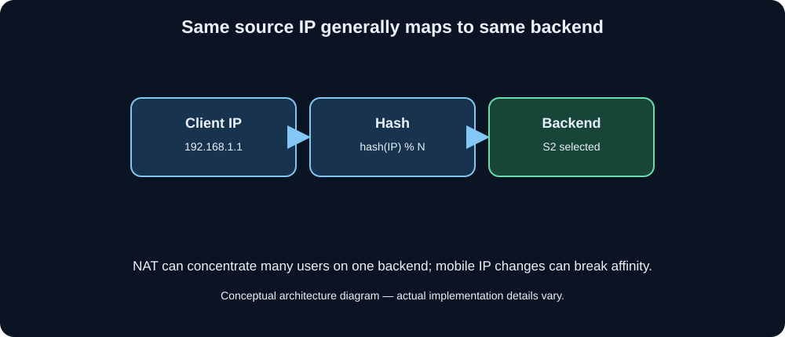

---

### 📌 Definition

The LB hashes the **client's IP address** to determine which server handles that client. The same IP always goes to the same server as long as the server pool doesn't change.

```
server_index = hash(client_IP) % number_of_servers
```

---

### ⚙️ How It Works — Step by Step

```
Client IP: 192.168.1.1
hash("192.168.1.1") = 3421947265
3421947265 % 3 = 1 → Always goes to S2

Client IP: 192.168.1.2
hash("192.168.1.2") = 1829374651
1829374651 % 3 = 2 → Always goes to S3
```

Every request from `192.168.1.1` → S2. Forever. This creates **session stickiness** (also called session persistence or session affinity).

This is specifically needed when **session data is stored in server memory** (not in a shared external store like Redis).

---

### ✅ Advantages

- Guarantees same user always hits same server
- Preserves in-memory session state without external session store
- Simple to implement
- Zero overhead for the session tracking — the IP itself carries the routing info

---

### ❌ Problems & Limits

**Problem 1: Breaks when server count changes**
Adding or removing a server changes `% N` to `% (N±1)`. Almost every client's hash changes. All users get routed to new servers → session loss for everyone → mass logout. This is the exact same catastrophe as the simple hashing problem from Part 2.

**Problem 2: Uneven distribution with NAT**
In offices, entire buildings might be behind a **single public IP** (NAT). So 500 employees all appear as the same IP → all go to S1 → S1 is overwhelmed while S2 and S3 are idle. The LB thinks it's being fair (one IP per server) but it's actually terrible.

**Problem 3: IP changes break stickiness**
Mobile users switching from WiFi to 4G get a new IP → go to a different server → session lost.

**Problem 4: Doesn't balance load**
S1 might get all the heavy users by luck of hash distribution. Load is "consistent" but not "even."

---

### 🔧 How to Solve

| Problem | Solution |
|---|---|
| Breaks on server count change | Use Consistent Hashing instead of `% N` |
| NAT/shared IP problem | Use cookie-based stickiness instead of IP-based |
| Mobile IP changes | Use cookie/token-based sessions |
| Uneven load | Move session state to external Redis → now you don't need IP hash at all |

---

### 🏠 Analogy

A bank assigns each customer to a permanent personal banker based on their account number. Customer #1234 always goes to Banker A. The problem: if Banker A handles 100 corporate clients (all account numbers happen to hash to A), Banker A drowns while B and C are relaxed.

---

### 🌍 Real-World Use

Old-school session management on legacy apps. Being replaced by: external session stores (Redis), JWTs (stateless auth), and consistent hashing.

Used by: Nginx (`ip_hash` directive), HAProxy.

---
---

## 6. Cookie-Based Sticky Sessions (Session Persistence)

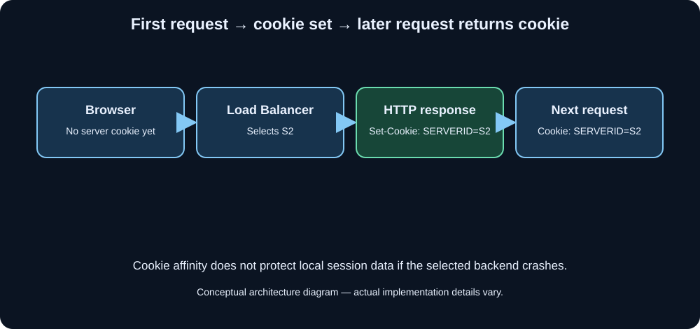

---

### 📌 Definition

A smarter form of stickiness. When a user first connects, the LB (or app server) sets a **cookie** in the browser that identifies which backend server handled the request. On every subsequent request, the browser sends that cookie, and the LB reads it to route back to the same server.

---

### ⚙️ How It Works — Step by Step

```
Step 1: User first visits site. No cookie yet.
Step 2: LB picks a server (by Round Robin or any algo) → say S2.
Step 3: LB inserts a cookie into the HTTP response:
        Set-Cookie: SERVERID=S2; Path=/
Step 4: Browser stores cookie.
Step 5: User makes next request. Browser sends:
        Cookie: SERVERID=S2
Step 6: LB reads cookie → routes to S2. Done.
```

No hashing needed. The routing info rides in the cookie itself.

---

### ✅ Advantages

- Not affected by IP changes (mobile users, NAT)
- Precise — cookie points to exactly one server, no hash collision issues
- Works even when server count changes (new users get load balanced, existing users keep their stickiness)
- Transparent to users

---

### ❌ Problems & Limits

**Problem 1: Cookie can be tampered with**
If not signed/encrypted, a user could manually set `SERVERID=S1` to force routing to a specific server. Solution: sign the cookie with a secret key.

**Problem 2: Cookie loss = session loss**
User clears cookies → goes to random server → session gone.

**Problem 3: Still doesn't solve the root problem**
Session data is still stored locally on S2. If S2 crashes, that user's session is gone regardless of sticky routing. The cookie now points to a dead server.

**Problem 4: Uneven load over time**
Heavy users (many long sessions) all stay on their initial servers. Light users rotate. Some servers accumulate long-lived heavy sessions and struggle.

---

### 🔧 How to Solve

The **real** solution: stop storing sessions in server memory. Store them in a shared external session store (Redis). Now:
- Any server can handle any user
- You don't need stickiness at all
- Server crashes don't lose session data
- Perfect horizontal scaling

---

### 🌍 Real-World Use

E-commerce checkout flows, banking portals, any legacy app where refactoring session management is expensive.

CGEC Socials note: If you store JWT tokens in cookies (not server-side session state), you don't need any stickiness — JWTs are self-contained and any server can verify them.

---
---

## 7. Least Response Time

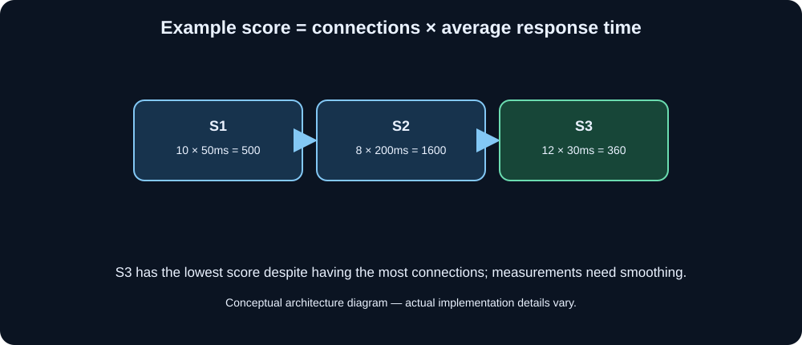

---

### 📌 Definition

The LB tracks the **actual response time** (how long each server takes to respond) along with active connections. It routes new requests to the server with the **lowest combination of active connections AND fastest response time**.

```
score = active_connections × average_response_time
```

Lowest score wins.

---

### ⚙️ How It Works — Step by Step

LB keeps a rolling average of response times:

```
S1: 10 connections, avg response = 50ms  → score = 10 × 50  = 500
S2: 8 connections,  avg response = 200ms → score = 8  × 200 = 1600
S3: 12 connections, avg response = 30ms  → score = 12 × 30  = 360
```

Next request → S3 (lowest score = 360), even though it has the most connections, because it's handling them very fast.

The LB updates these scores continuously based on observed response times from recent requests.

---

### ✅ Advantages

- Uses **actual server performance data**, not just connection counts
- Naturally routes away from slow servers (which could indicate CPU/memory pressure)
- Self-adjusting — if S2 starts responding faster after its heavy job finishes, it'll start getting more traffic
- Best algorithm for real-world mixed workloads

---

### ❌ Problems & Limits

**Problem 1: Measurement overhead**
The LB must time every response to every server and maintain rolling averages. At very high traffic this adds non-trivial overhead.

**Problem 2: Latency in measurements**
Response time is measured at the LB. If the network between LB and server has jitter, response time varies unpredictably and scores fluctuate.

**Problem 3: Cold start**
New server has no history → LB doesn't know its response time → might overload it initially.

**Problem 4: Short-term noise**
One unusually slow request (e.g., a database deadlock that resolved in 2 seconds) spikes a server's average → LB avoids it → that server sits idle even though it's now fine.

---

### 🔧 How to Solve

| Problem | Solution |
|---|---|
| Measurement overhead | Sample instead of measuring every request |
| Cold start | Use slow-start: begin new servers at low weight, increase gradually |
| Short-term noise | Use exponentially weighted moving average (EWMA) — recent data counts more, old spikes fade out |

---

### 🏠 Analogy

Same hospital. The receptionist now has a stopwatch. She not only counts how many patients each doctor has, but also times how long each consultation takes. She routes new patients to the doctor who is both fast AND currently least occupied.

---

### 🌍 Real-World Use

HAProxy's `leastconn` with response time monitoring. Nginx Plus. F5 BIG-IP. Used in high-performance API gateways where request latency varies significantly.

---
---

## 8. Random

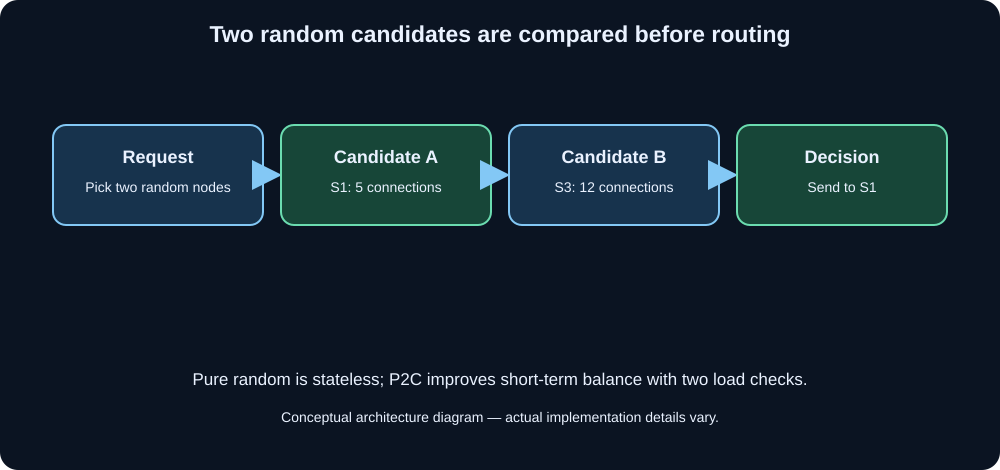

---

### 📌 Definition

Pick a server completely at random for each request. No tracking, no history, no weights. Pure randomness.

```
server = random_choice([S1, S2, S3])
```

---

### ⚙️ How It Works

```
Request 1 → random number → S3
Request 2 → random number → S1
Request 3 → random number → S1
Request 4 → random number → S2
...
```

---

### ✅ Advantages

- Stateless — LB doesn't need to maintain any per-server data
- No coordination needed in distributed LB setups (multiple LB instances don't need to sync)
- Surprisingly effective at scale — by the law of large numbers, distribution is roughly even over many requests
- Extremely fast to compute

---

### ❌ Problems & Limits

**Problem 1: Short-term imbalance**
Over 10 requests, by bad luck, S1 might get 7 and S3 might get 1. This smooths out over millions of requests, but short bursts can be very uneven.

**Problem 2: No awareness of server state**
If S2 is overloaded, random still sends ~1/N of requests there.

**Problem 3: No stickiness**
Can't use this if you need session affinity.

---

### 🔧 How to Solve: Power of Two Choices (P2C)

This is a beautiful upgrade to random. Instead of picking 1 random server, pick **2 random servers**, check their load, and send the request to the **less loaded of the two**.

```
Step 1: Pick 2 random servers at random: S1 and S3
Step 2: Check connections: S1=5, S3=12
Step 3: Send to S1 (fewer connections)
```

This sounds like it barely helps, but mathematically it reduces the maximum load on any server from O(log N / log log N) in pure random to O(log log N) — exponentially better balancing, with almost zero overhead (just two lookups instead of one).

P2C is used at massive scale (Twitter's Finagle library uses it).

---

### 🌍 Real-World Use

Random is used in simple scripts, internal microservice routing, and as a fallback. P2C is used in production at Twitter (Finagle), Envoy Proxy, and other high-scale service meshes.

---
---

## 9. URL / Content-Based Routing (Layer 7 Routing)

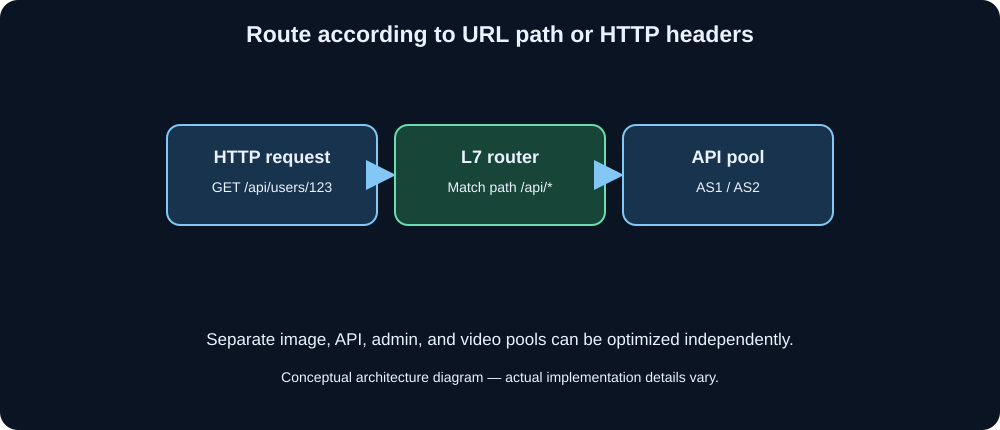

---

### 📌 Definition

The LB reads the actual HTTP request content — URL path, headers, query parameters, cookies — and routes based on **what the request is**, not just who it came from or how many connections a server has.

This requires a **Layer 7** (Application Layer) load balancer.

---

### ⚙️ How It Works — Step by Step

You have 3 specialized server groups:

```
Image servers:  IS1, IS2 (optimized for static file serving, CDN cache)
API servers:    AS1, AS2 (Node.js/Python apps)
Admin servers:  AD1      (special access)
```

LB rules:

```
IF URL starts with /images/*  → route to Image Server pool
IF URL starts with /api/*     → route to API Server pool
IF URL starts with /admin/*   → route to Admin Server pool
IF Header: Content-Type = video/* → route to Video Processing pool
```

Incoming requests:

```
GET /api/users/123        → AS1 or AS2
GET /images/profile.jpg   → IS1 or IS2
POST /admin/settings      → AD1
```

---

### ✅ Advantages

- Different server types optimized for different tasks
- Security isolation (admin routes can't accidentally hit public servers)
- Microservices: each service team deploys independently behind their own pool
- A/B testing: route 10% of `/checkout` traffic to new checkout system
- Canary deployments: route traffic from beta users (cookie: `beta=true`) to new version

---

### ❌ Problems & Limits

**Problem 1: Higher overhead**
LB must fully parse the HTTP request to read URL/headers. Much more CPU-intensive than Layer 4.

**Problem 2: Complexity**
Routing rules can grow into hundreds of conditions. Hard to manage and debug.

**Problem 3: TLS termination required**
To read HTTP content, the LB must decrypt HTTPS traffic (TLS termination). This means the LB handles certificate management and re-encrypts traffic to backends. Adds latency.

**Problem 4: Misconfiguration risk**
Wrong rules can send sensitive admin routes to public servers, creating security holes.

---

### 🔧 How to Solve

| Problem | Solution |
|---|---|
| Overhead | Use hardware-accelerated SSL offload; keep routing rules simple |
| Complexity | Use infrastructure-as-code (Terraform, Helm) to manage rules |
| TLS overhead | Terminate TLS at LB, use mTLS between LB and backends (zero-trust) |
| Misconfiguration | Use policy-as-code (OPA/Gatekeeper), automated testing of routing rules |

---

### 🏠 Analogy

An airport terminal. Each gate is a server pool. The gate assignment board (LB) reads your boarding pass (HTTP request): domestic flights go to Terminal A, international to Terminal B, VIP lounge to Terminal C. It doesn't just rotate you through gates — it reads what your ticket says.

---

### 🌍 Real-World Use

This is **exactly** what AWS Application Load Balancer (ALB) does. You set rules like:
- Path `/api/*` → Target Group A (ECS containers running your API)
- Path `/static/*` → Target Group B (S3-backed CDN)
- Header `X-Internal: true` → Target Group C (internal services)

Also: Nginx (location blocks), Istio service mesh, Kong API Gateway.

---
---

## 10. Resource-Based / Adaptive Load Balancing

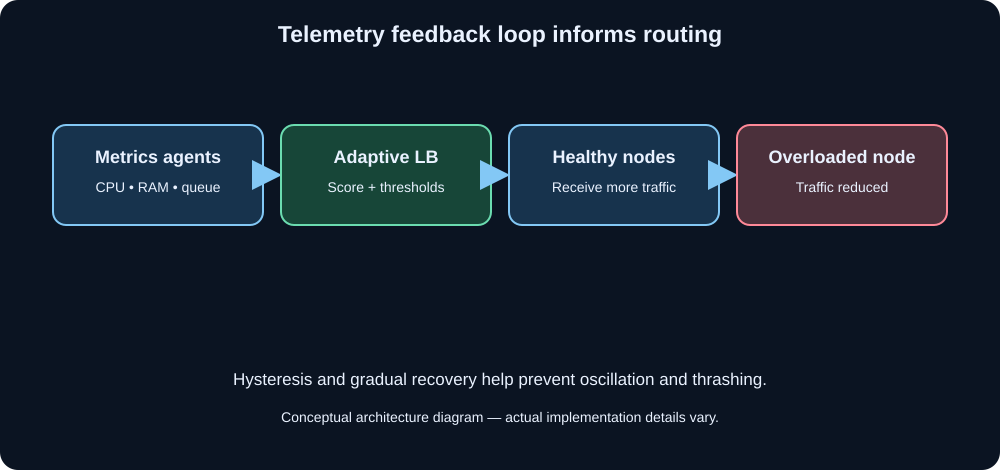

---

### 📌 Definition

The LB uses **real-time telemetry from the servers themselves** — actual CPU %, memory %, disk I/O, queue depth — to make routing decisions. Servers push their current health metrics to the LB, and the LB routes away from overloaded servers.

---

### ⚙️ How It Works — Step by Step

Each server runs a small agent that pushes metrics to the LB every few seconds:

```
S1 reports: CPU=25%, RAM=40%, queue_depth=2
S2 reports: CPU=85%, RAM=70%, queue_depth=15  ← overloaded
S3 reports: CPU=30%, RAM=45%, queue_depth=3
```

LB computes a composite score per server:

```
S1 score = weighted(CPU, RAM, queue) = low   → eligible
S2 score = weighted(CPU, RAM, queue) = high  → reduced traffic
S3 score = weighted(CPU, RAM, queue) = low   → eligible
```

New requests primarily go to S1 and S3. S2 gets minimal new traffic until it recovers.

---

### ✅ Advantages

- Uses ground truth — actual CPU/RAM, not proxies like connection count
- Handles all types of load: CPU-bound, memory-bound, I/O-bound
- Self-healing: overloaded servers naturally get relief until they recover
- Can prevent cascading failures before they happen

---

### ❌ Problems & Limits

**Problem 1: Complexity**
Requires instrumentation on every server, a metrics pipeline, and complex scoring logic in the LB. Much harder to set up and maintain.

**Problem 2: Metric lag**
Servers push metrics every few seconds. In that interval, a server could go from 10% to 100% CPU. The LB is always working with slightly stale data.

**Problem 3: Oscillation**
LB sees S2 is overloaded → stops sending to S2 → S2 recovers → LB floods S2 again → S2 overloads again → repeat. This "thrashing" can make performance worse.

**Problem 4: Metric accuracy**
"CPU 90%" on a server doing purely network I/O vs. CPU 90% on a server doing pure computation are very different situations.

---

### 🔧 How to Solve

| Problem | Solution |
|---|---|
| Oscillation | Add hysteresis (don't reroute back to a recovered server immediately — wait for it to be stable for X seconds) |
| Metric lag | Push metrics more frequently (at the cost of more network overhead); use circuit breaker pattern |
| Complexity | Use service mesh (Istio, Linkerd) which handles all this automatically |

---

### 🌍 Real-World Use

F5 BIG-IP's adaptive load balancing. AWS uses this internally for its infrastructure. Service meshes like Istio do this between microservices automatically.

---
---

## 11. Geographic / Geo-DNS Load Balancing

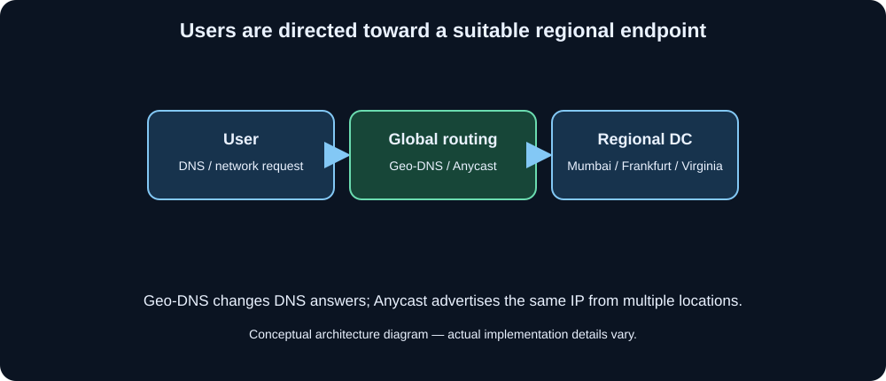

---

### 📌 Definition

Route users to the **data center or server cluster geographically closest to them**, reducing network latency dramatically.

---

### ⚙️ How It Works

DNS-based: When a user queries `www.cgecsocial.in`, the DNS server looks at the user's IP, determines their geographic location, and returns the IP of the nearest data center.

```
User in India     → DNS returns IP of Mumbai data center
User in Germany   → DNS returns IP of Frankfurt data center
User in USA       → DNS returns IP of Virginia data center
```

Alternatively, anycast routing: the same IP address is announced from multiple data centers, and BGP (internet routing protocol) automatically routes each user's packet to the nearest one.

---

### ✅ Advantages

- Massively reduces latency (Mumbai datacenter is 10ms from Indian users, Virginia is 200ms)
- Natural isolation: regional outage in one DC doesn't affect others
- Compliance: European data can stay in European DCs (GDPR)

---

### ❌ Problems & Limits

**Problem 1: DNS caching**
DNS results are cached by ISPs for the TTL duration. If you need to quickly failover a DC, the old IPs are stuck in caches for hours.

**Problem 2: Uneven traffic**
Population concentration means certain regions have far more users. Asia might have 10x more traffic than South America.

**Problem 3: Data consistency**
If a user creates data in Mumbai, then travels to Germany and their requests go to Frankfurt, Frankfurt might not have their latest data yet (replication lag).

---

### 🏠 Analogy

McDonald's doesn't route every customer in India to a restaurant in New York. They have local franchises in every city. Geo Load Balancing = same idea, but for server requests.

---

### 🌍 Real-World Use

Cloudflare (anycast), AWS Route 53 with Latency-based routing, Akamai CDN. Every major global app does this — Netflix, YouTube, Facebook.

---
---

## The Master Comparison Table

| Algorithm | State Needed | Layer | Best For | Worst For |
|---|---|---|---|---|
| Round Robin | Minimal (counter) | L4/L7 | Identical servers, identical requests | Mixed hardware, mixed workloads |
| Weighted RR | Minimal (weights) | L4/L7 | Different capacity servers | Dynamic workloads, long connections |
| Least Connections | Per-server count | L4/L7 | Long-lived connections, varied request time | CPU-bound workloads |
| Weighted Least Conn | Count + weights | L4/L7 | Mixed hardware + varied workloads | Very dynamic workloads |
| IP Hash | None (stateless) | L4/L7 | Session stickiness (legacy) | Mobile users, office NAT, scaling |
| Cookie Sticky | Cookie store | L7 | Session stickiness (better than IP) | Requires L7, cookie hygiene |
| Least Response Time | Response history | L7 | APIs with highly variable latency | High-frequency, tiny requests (overhead) |
| Random | None | L4/L7 | Stateless, massive scale, simplicity | Short bursts, session needs |
| P2C (Random+2) | Minimal | L4/L7 | Stateless, massive scale, better than random | Same as random but strictly better |
| URL/Content-Based | Routing rules | L7 only | Microservices, A/B testing, security isolation | Needs TLS termination, more CPU |
| Resource-Based | Full telemetry | L7 | Mixed workloads, preventing cascades | High complexity, metric lag |
| Geographic | Location data | DNS/BGP | Global apps, latency-sensitive | Small single-region apps |

---

## 🏗️ How Real Systems Combine These

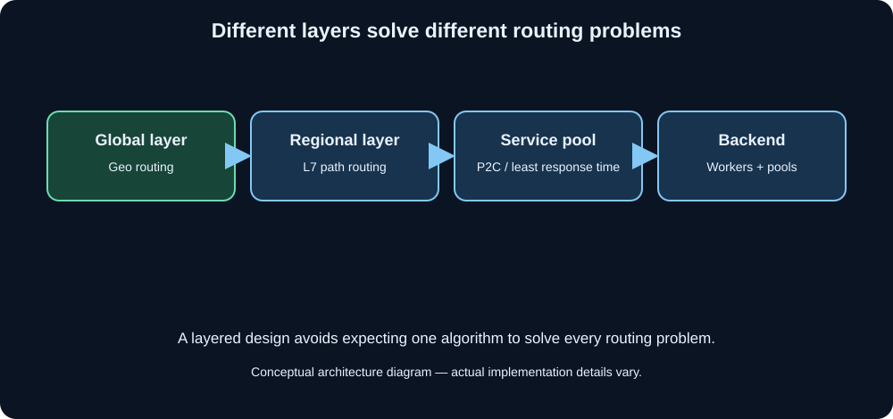

No real production system uses just one algorithm. They layer them:

```
Level 1: Geographic LB
   → Routes Indian users to Mumbai, US users to Virginia

Level 2: Within Mumbai datacenter — URL-based routing
   → /api/* → API server pool
   → /images/* → CDN/static server pool

Level 3: Within API server pool — Least Response Time or P2C
   → Routes to least loaded API server

Level 4: Within each server — connection pooling
   → Each server manages its own worker processes
```

This is exactly how **Netflix, Uber, Amazon** work. Each layer solves a different problem.

---

## The One Mental Framework to Remember All of This

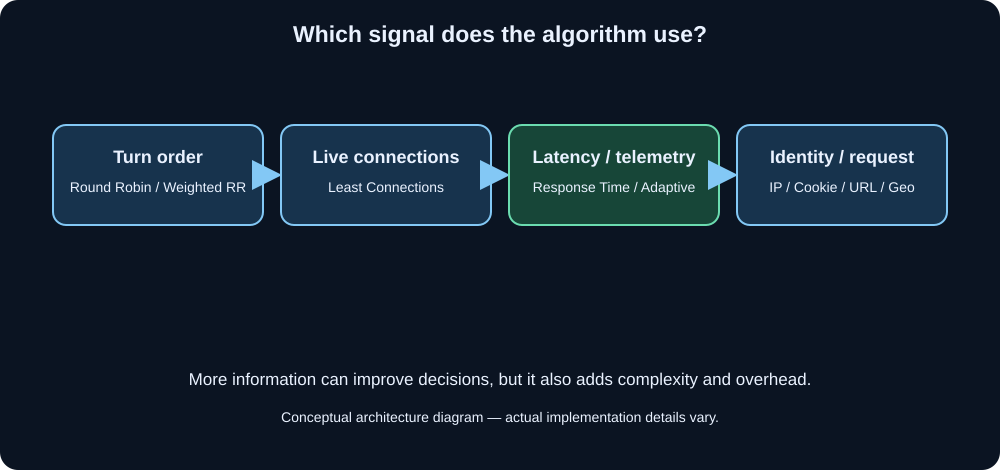

Every load balancing algorithm answers the same question: **"Which server should this request go to right now?"**

Each algorithm uses different **information** to answer it:

```
Round Robin       → "It's this server's turn."
Weighted RR       → "It's this server's turn, proportional to its capacity."
Least Connections → "This server has the most room right now."
Least Resp. Time  → "This server is both fast AND free right now."
IP Hash           → "This server is this user's permanent home."
URL Routing       → "This request type belongs to this server group."
Resource-Based    → "This server is actually least stressed right now."
Geographic        → "This server is physically closest to this user."
```

More information → better decisions → better load balancing. But also more complexity and overhead. The right algorithm depends entirely on your specific system's needs.