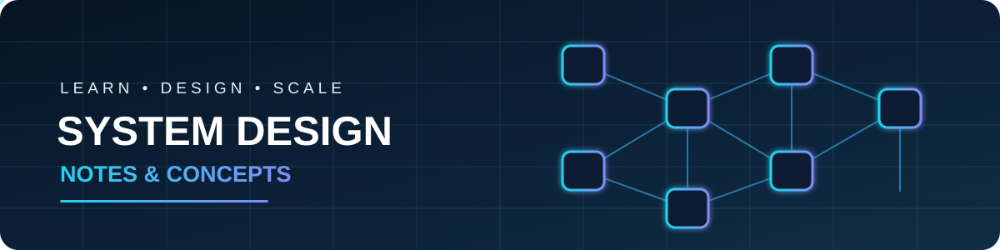

# System Design Notes

**A practical, continuously growing collection of system design concepts, patterns, trade-offs, and real-world examples.**

[Concepts](#-what-youll-find) · [Learning Path](#-learning-path) · [Repository Structure](#-repository-structure) · [Resources](#-useful-resources)

---

## 🎯 About

This repository is my personal knowledge base for learning **System Design** — from the fundamentals of building scalable applications to designing reliable, distributed systems.

I use it to organize concepts, write explanations in my own words, document examples, and keep track of what I learn. The goal is not just to memorize definitions, but to understand **why a design decision is made, when to use it, and what trade-offs it introduces**.

## 📚 What You'll Find

- Clear explanations of core system design concepts.
- Architecture patterns and design approaches.
- Scalability, availability, reliability, and performance techniques.
- Databases, caching, messaging, and storage.
- High-level design (HLD) notes and architecture diagrams.
- Real-world system design case studies.
- Trade-offs, limitations, and practical examples.

## 🧭 Learning Path

The topics are organized roughly from foundational concepts to more advanced distributed-system ideas.

| Stage | Area | Topics |
|---|---|---|
| 01 | Fundamentals | Client-server architecture, latency, throughput, bandwidth |
| 02 | Scaling | Vertical scaling, horizontal scaling, load balancing |
| 03 | API Design | REST, GraphQL, API gateways, rate limiting |
| 04 | Data Storage | SQL, NoSQL, indexing, replication, partitioning, sharding |
| 05 | Performance | Caching, CDN, compression, asynchronous processing |
| 06 | Distributed Systems | Consistency, availability, CAP theorem, consensus |
| 07 | Messaging | Message queues, event-driven architecture, pub/sub, Kafka |
| 08 | Reliability | Fault tolerance, retries, timeouts, circuit breakers |
| 09 | Architecture | Monoliths, microservices, service discovery |
| 10 | Case Studies | URL shortener, chat system, news feed, video streaming |

> This is a living roadmap. Topics may be added, reordered, or expanded as I learn.

## 🧠 How I Document Each Concept

Where relevant, I try to cover each topic using this structure:

1. **What is it?** — A simple definition.
2. **Why do we need it?** — The problem it solves.
3. **How does it work?** — The internal flow or mechanism.
4. **When should we use it?** — Practical use cases.
5. **Trade-offs** — Advantages, limitations, and alternatives.
6. **Example** — A real-world or simplified scenario.

## 🛠️ Design Principles I Keep in Mind

- Every design decision has trade-offs.
- Start simple; add complexity when requirements justify it.
- Optimize based on bottlenecks, not assumptions.
- Plan for failure in distributed systems.
- Measure latency, throughput, and resource usage.
- Consider consistency, availability, scalability, and cost together.

## 📈 Progress

- [ ] System design fundamentals
- [ ] Scaling and load balancing
- [ ] API design and rate limiting
- [ ] Database design and indexing
- [ ] Caching and CDN
- [ ] Distributed systems fundamentals
- [ ] Messaging and event-driven architecture
- [ ] Reliability and fault tolerance
- [ ] Architecture patterns
- [ ] End-to-end system design case studies

## 🔗 Useful Resources

- [System Design Primer](https://github.com/donnemartin/system-design-primer)
- [ByteByteGo](https://bytebytego.com/)
- [Google SRE Books](https://sre.google/books/)
- [AWS Architecture Center](https://aws.amazon.com/architecture/)
- [Martin Fowler — Software Architecture](https://martinfowler.com/architecture/)

## 🤝 Contributions

This is primarily a personal learning repository, but suggestions, corrections, and useful resources are welcome. If you spot an issue, feel free to open an issue or submit a pull request.

---

**Learn the concept. Understand the trade-off. Design the system.**

⭐ If these notes help you, consider starring the repository.

